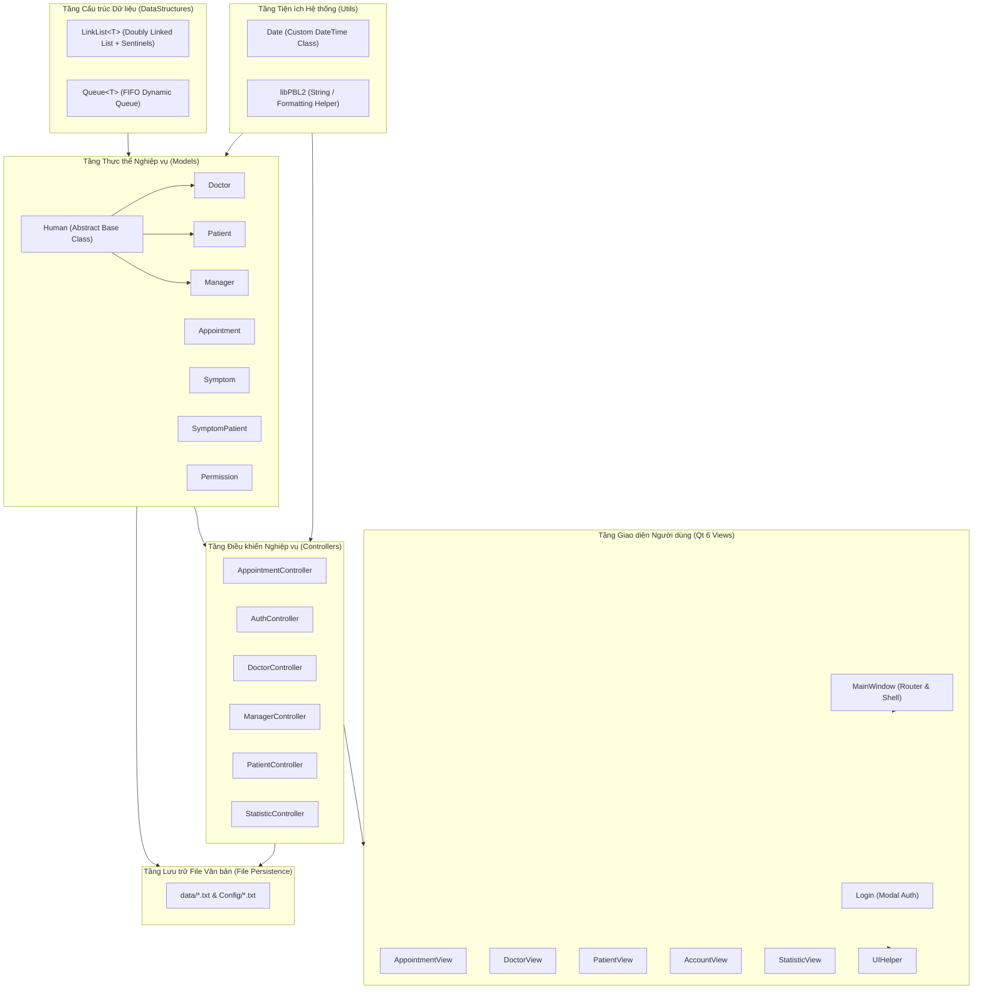
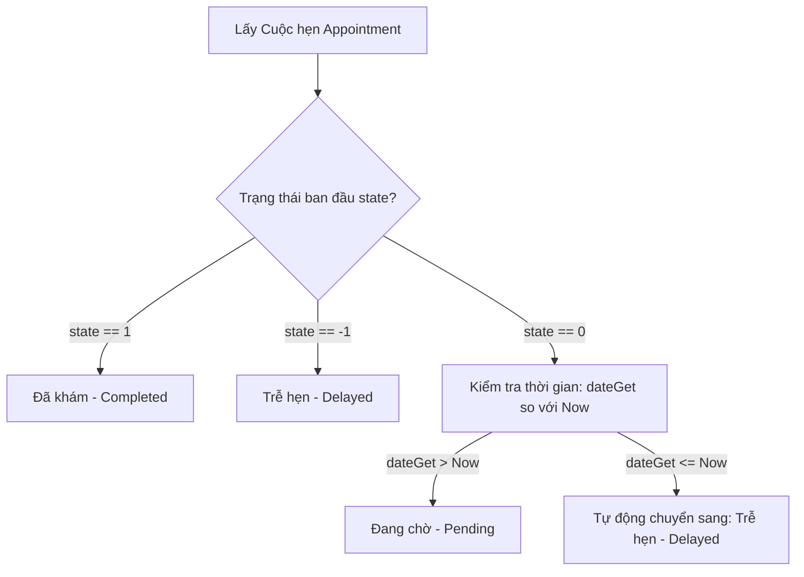

# 🔬 TÀI LIỆU PHÂN TÍCH TOÀN BỘ SOURCE CODE, CẤU TRÚC DỮ LIỆU & THUẬT TOÁN (AnTamMng)

> **Tài liệu kỹ thuật chuyên sâu phân tích toàn diện mã nguồn, nguyên lý hướng đối tượng (OOP), cấu trúc dữ liệu tự xây dựng (Zero STL), các bộ điều khiển nghiệp vụ (Controllers), hệ thống giao diện người dùng (Qt Views), trình khởi chạy (C Launcher) và toàn bộ giải thuật cốt lõi trong hệ thống Quản lý Phòng Khám An Tâm.**

---

## 📑 MỤC LỤC CHI TIẾT

1. [Kiến trúc Tổng thể của Source Code (System Architecture)](#1-kiến-trúc-tổng-thể-của-source-code-system-architecture)
2. [Cấu trúc Dữ liệu Tự xây dựng (Data Structures - Zero Forbidden STL)](#2-cấu-trúc-dữ-liệu-tự-xây-dựng-data-structures---zero-forbidden-stl)
   - [2.1. LinkList&lt;T&gt; (Doubly Linked List with Sentinels)](#21-linklistt-doubly-linked-list-with-sentinels)
   - [2.2. Queue&lt;T&gt; (FIFO Queue with Dynamic Pointer Allocation)](#22-queuet-fifo-queue-with-dynamic-pointer-allocation)
3. [Thư viện Tiện ích & Xử lý Thời gian (Utils)](#3-thư-viện-tiện-ích--xử-lý-thời-gian-utils)
   - [3.1. Lớp Ngày tháng Thời gian: Date](#31-lớp-ngày-tháng-thời-gian-date)
   - [3.2. Không gian tên Tiện ích: libPBL2](#32-không-gian-tên-tiện-ích-libpbl2)
4. [Các Lớp Thực thể Nghiệp vụ (Domain Models - OOP Design)](#4-các-lớp-thực-thể-nghiệp-vụ-domain-models---oop-design)
   - [4.1. Lớp Cơ sở Trừu tượng: Human](#41-lớp-cơ-sở-trừu-tượng-human)
   - [4.2. Lớp Thực thể Bác sĩ: Doctor](#42-lớp-thực-thể-bác-sĩ-doctor)
   - [4.3. Lớp Thực thể Bệnh nhân: Patient](#43-lớp-thực-thể-bệnh-nhân-patient)
   - [4.4. Lớp Thực thể Quản trị & Nhân sự: Manager](#44-lớp-thực-thể-quản-trị--nhân-sự-manager)
   - [4.5. Lớp Thực thể Cuộc hẹn Khám bệnh: Appointment](#45-lớp-thực-thể-cuộc-hẹn-khám-bệnh-appointment)
   - [4.6. Lớp Thực thể Triệu chứng Lâm sàng: Symptom](#46-lớp-thực-thể-triệu-chứng-lâm-sàng-symptom)
   - [4.7. Lớp Liên kết Bệnh án Triệu chứng: SymptomPatient](#47-lớp-liên-kết-bệnh-án-triệu-chứng-symptompatient)
   - [4.8. Lớp Thực thể Bản ghi Phân quyền: Permission](#48-lớp-thực-thể-bản-ghi-phân-quyền-permission)
5. [Các Bộ Điều khiển Nghiệp vụ (Controllers Layer)](#5-các-bộ-điều-khiển-nghiệp-vụ-controllers-layer)
   - [5.1. AppointmentController](#51-appointmentcontroller)
   - [5.2. AuthController](#52-authcontroller)
   - [5.3. DoctorController](#53-doctorcontroller)
   - [5.4. ManagerController](#54-managercontroller)
   - [5.5. PatientController](#55-patientcontroller)
   - [5.6. StatisticController](#56-statisticcontroller)
6. [Tầng Giao diện Người dùng & Điều phối Tương tác (Views & UI Architecture)](#6-tầng-giao-diện-người-dùng--điều-phối-tương-tác-views--ui-architecture)
   - [6.1. MainWindow (Lớp Điều phối Trung tâm)](#61-mainwindow-lớp-điều-phối-trung-tâm)
   - [6.2. Login (Xác thực Đăng nhập & Đồ họa Y tế)](#62-login-xác-thực-đăng-nhập--đồ-họa-y-tế)
   - [6.3. AppointmentView (Điều phối Lịch khám & Sàng lọc Triage)](#63-appointmentview-điều-phối-lịch-khám--sàng-lọc-triage)
   - [6.4. DoctorView (Quản lý Bác sĩ & Lịch làm việc)](#64-doctorview-quản-lý-bác-sĩ--lịch-làm-việc)
   - [6.5. PatientView (Quản lý Bệnh nhân & Hồ sơ Bệnh án)](#65-patientview-quản-lý-bệnh-nhân--hồ-sơ-bệnh-án)
   - [6.6. StatisticView (Báo cáo Thống kê Trực quan với QtCharts)](#66-statisticview-báo-cáo-thống-kê-trực-quan-với-qtcharts)
   - [6.7. AccountView (Quản lý Nhân sự & Phân quyền Động)](#67-accountview-quản-lý-nhân-sự--phân-quyền-động)
   - [6.8. UIHelper (Bộ Tiện ích Giao diện & Xử lý Chuỗi)](#68-uihelper-bộ-tiện-ích-giao-diện--xử-lý-chuỗi)
7. [Trình Khởi chạy Portable & Cơ chế Ghi Log An toàn Đa luồng](#7-trình-khởi-chạy-portable--cơ-chế-ghi-log-an-toàn-đa-luồng)
   - [7.1. C Portable Launcher (launcher.c)](#71-c-portable-launcher-launcherc)
   - [7.2. Thread-Safe Logging System (src/main.cpp)](#72-thread-safe-logging-system-srcmaincpp)
8. [Các Giải thuật Cốt lõi của Hệ thống (Core System Algorithms)](#8-các-giải-thuật-cốt-lõi-của-hệ-thống-core-system-algorithms)
   - [8.1. Thuật toán Phân loại Sàng lọc Y tế (Medical Triage Scoring)](#81-thuật-toán-phân-loại-sàng-lọc-y-tế-medical-triage-scoring)
   - [8.2. Thuật toán Gợi ý Bác sĩ Tối ưu (Doctor Recommendation Algorithm)](#82-thuật-toán-gợi-ý-bác-sĩ-tối-ưu-doctor-recommendation-algorithm)
   - [8.3. Thuật toán Phát hiện Xung đột Lịch hẹn (Appointment Slot Conflict Detection)](#83-thuật-toán-phát-hiện-xung-đột-lịch-hẹn-appointment-slot-conflict-detection)
   - [8.4. Thuật toán Tính toán Trạng thái Động của Cuộc hẹn (Dynamic Effective State Evaluation)](#84-thuật-toán-tính-toán-trạng-thái-động-của-cuộc-hẹn-dynamic-effective-state-evaluation)
   - [8.5. Thuật toán Chuẩn hóa & Tìm kiếm Tiếng Việt Không Dấu (Vietnamese Search Normalization)](#85-thuật-toán-chuẩn-hóa--tìm-kiếm-tiếng-việt-không-dấu-vietnamese-search-normalization)
   - [8.6. Thuật toán Tính toán Chu kỳ Nghỉ Tết Âm Lịch (Lunar New Year Evaluation)](#86-thuật-toán-tính-toán-chu-kỳ-nghỉ-tết-âm-lịch-lunar-new-year-evaluation)
   - [8.7. Thuật toán Sinh Mã Định danh Tự Tăng (Auto-increment ID Generation)](#87-thuật-toán-sinh-mã-định-danh-tự-tăng-auto-increment-id-generation)
9. [Bảng Ma trận Độ Phức Tạp Thuật Toán Toàn Diện (Complexity Matrix)](#9-bảng-ma-trận-độ-phức-tạp-thuật-toán-toàn-diện-complexity-matrix)
10. [Quy chuẩn Lưu trữ & Phân tích Dữ liệu (File Persistence & Parsing Specs)](#10-quy-chuẩn-lưu-trữ--phân-tích-dữ-liệu-file-persistence--parsing-specs)

---

## 1. KIẾN TRÚC TỔNG THỂ CỦA SOURCE CODE (SYSTEM ARCHITECTURE)

Dự án **AnTamMng** áp dụng kiến trúc **M-C-V (Model - View - Controller)** mở rộng kết hợp tầng tiện ích (Utils) và cấu trúc dữ liệu tự định nghĩa (DataStructures):



### Nguyên tắc Ràng buộc Kỹ thuật (Quy tắc Zero Forbidden STL Rule)
Toàn bộ mã nguồn nghiệp vụ của dự án **không sử dụng bất kỳ thư viện vùng chứa hoặc giải thuật có sẵn nào của STL**:
* ❌ **Bị cấm:** `<algorithm>`, `<vector>`, `<map>`, `<set>`, `<functional>`, `<list>`, `<deque>`, `<queue>`, `<stack>`, `<utility>`, `<memory>`, `<tuple>`.
*  **Hiện thực thay thế:**
  - `LinkList<T>`: Cấu trúc danh sách liên kết đôi có 2 nút canh giữ (Sentinels), dùng cho toàn bộ hoạt động nạp, duyệt, tìm kiếm, sắp xếp và lưu trữ dữ liệu.
  - `Queue<T>`: Hàng đợi tuyến tính FIFO cấp phát động theo cơ chế con trỏ, phục vụ hàng đợi tiếp đón và xử lý tuần tự.
  - Sắp xếp: Tự hiện thực các giải thuật sắp xếp kinh điển (Bubble Sort, Selection Sort, Insertion Sort) trực tiếp trên con trỏ node hoặc mảng con trỏ.

---

## 2. CẤU TRÚC DỮ LIỆU TỰ XÂY DỰNG (DATA STRUCTURES - ZERO FORBIDDEN STL)

### 2.1. `LinkList<T>` (Doubly Linked List with Sentinels)
* **Tệp nguồn:** [`src/DataStructures/LinkList.h`](file:///d:/Documents/Project/pbl_2/pbl2_v1.1/src/DataStructures/LinkList.h)
* **Ý tưởng thiết kế:** Danh sách liên kết đôi sử dụng 2 nút canh giữ (Dummy Sentinel Nodes) là `header` và `footer`.
  - **Lợi ích kiến trúc:** Loại bỏ hoàn toàn các trường hợp biên đặc biệt (edge cases) khi chèn hoặc xóa phần tử đầu danh sách hoặc cuối danh sách. Không bao giờ có nút dữ liệu thực nào trỏ tới `nullptr`.

#### Cấu trúc Nút (Node Struct)
```cpp
template <class T>
struct Node {
    T info;       // Dữ liệu thực kiểu T
    Node *next;   // Con trỏ tới nút kế tiếp
    Node *prev;   // Con trỏ tới nút liền trước
};
```

#### Phân tích Các Thuật toán Cốt lõi của `LinkList<T>`:

1. **Khởi tạo (Constructor):**
   - Cấp phát 2 nút rỗng: `header = new Node; footer = new Node;`.
   - Thiết lập liên kết khởi điểm:
     ```cpp
     header->next = footer;
     footer->prev = header;
     header->prev = nullptr;
     footer->next = nullptr;
     count = 0;
     ```
   - **Độ phức tạp:** Thời gian $\mathcal{O}(1)$, Không gian $\mathcal{O}(1)$.

2. **Chèn phần tử (Chèn đuôi - `insert(const T &info)`):**
   - Cấp phát động một `Node` mới: `Node *tmp = new Node; tmp->info = info;`.
   - Chèn `tmp` vào ngay trước nút canh giữ `footer`:
     ```cpp
     tmp->next = footer;
     tmp->prev = footer->prev;
     footer->prev->next = tmp;
     footer->prev = tmp;
     count++;
     ```
   - **Độ phức tạp:** Thời gian $\mathcal{O}(1)$, Không gian $\mathcal{O}(1)$.

3. **Xóa phần tử (`remove(Node *N)`):**
   - Kiểm tra an toàn: Nếu $N == nullptr$ hoặc $N == header$ hoặc $N == footer$, lập tức từ chối và trả về `false`.
   - Ngắt kết nối nút $N$ khỏi chuỗi liên kết đôi:
     ```cpp
     N->next->prev = N->prev;
     N->prev->next = N->next;
     delete N;
     count--;
     return true;
     ```
   - **Độ phức tạp:** Thời gian $\mathcal{O}(1)$ khi đã có con trỏ nút cần xóa.

4. **Sao chép sâu (Copy Constructor & `operator=`):**
   - Khởi tạo danh sách mới với 2 sentinel nodes.
   - Duyệt tuần tự con trỏ `Node *curr = other.header->next;` đến trước `other.footer`.
   - Gọi `insert(curr->info)` cho từng node để sao chép sâu toàn bộ dữ liệu, tránh lỗi shallow copy dẫn tới dangling pointer.
   - **Độ phức tạp:** Thời gian $\mathcal{O}(N)$, Không gian $\mathcal{O}(N)$.

5. **Giải phóng bộ nhớ (Destructor & `clear()`):**
   - Duyệt từ `header`, lưu biến tạm `Node *next = curr->next;` rồi thực thi `delete curr;` đến khi hết danh sách.
   - Đảm bảo 100% không rò rỉ bộ nhớ (Zero Memory Leak).
   - **Độ phức tạp:** Thời gian $\mathcal{O}(N)$.

---

### 2.2. `Queue<T>` (FIFO Queue with Dynamic Pointer Allocation)
* **Tệp nguồn:** [`src/DataStructures/Queue.h`](file:///d:/Documents/Project/pbl_2/pbl2_v1.1/src/DataStructures/Queue.h)
* **Ý tưởng thiết kế:** Hàng đợi tuyến tính vào trước - ra trước (First-In, First-Out), hiện thực bằng danh sách liên kết đôi có sentinel. Dữ liệu trong mỗi node được cấp phát động dạng con trỏ `T *data`.

#### Cấu trúc Nút (Node Struct)
```cpp
template <class T>
struct Node {
    Node *next;
    Node *prev;
    T *data;      // Con trỏ dữ liệu được cấp phát động
};
```

#### Phân tích Các Thuật toán Cốt lõi của `Queue<T>`:

1. **Đưa vào hàng đợi (`enQueue(const T &value)`):**
   - Cấp phát `Node` mới và sao chép dữ liệu: `node->data = new T(value);`.
   - Đưa nút mới vào vị trí đuôi hàng đợi (ngay trước `footer`):
     ```cpp
     node->next = footer;
     node->prev = footer->prev;
     footer->prev->next = node;
     footer->prev = node;
     ```
   - **Độ phức tạp:** Thời gian $\mathcal{O}(1)$.

2. **Lấy khỏi hàng đợi (`deQueue()`):**
   - Kiểm tra rỗng: Nếu `header->next == footer`, trả về `nullptr`.
   - Lấy nút đầu tiên thực tế: `Node *node = header->next;`.
   - Tạo bản sao dữ liệu an toàn để trả về cho caller: `T *copy = new T(*node->data);`.
   - Cập nhật liên kết bỏ qua nút đầu: `header->next = node->next; node->next->prev = header;`.
   - Giải phóng bộ nhớ của `node->data` và `node`, trả về con trỏ `copy`.
   - **Độ phức tạp:** Thời gian $\mathcal{O}(1)$.

---

## 3. THƯ VIỆN TIỆN ÍCH & XỬ LÝ THỜI GIAN (UTILS)

### 3.1. Lớp Ngày tháng Thời gian: `Date`
* **Tệp nguồn:** [`src/Utils/Date.h`](file:///d:/Documents/Project/pbl_2/pbl2_v1.1/src/Utils/Date.h) & [`src/Utils/Date.cpp`](file:///d:/Documents/Project/pbl_2/pbl2_v1.1/src/Utils/Date.cpp)
* **Trường dữ liệu:** `int day`, `int month`, `int year`, `int hour`, `int minute`.

#### Các Thuật toán Xử lý Lịch pháp:

1. **Kiểm tra Năm Nhuận (`isLeapYear(int y)`):**
   - Một năm $y$ là năm nhuận theo lịch Gregorius khi:
     $$(\text{year} \pmod{400} == 0) \lor ((\text{year} \pmod{4} == 0) \land (\text{year} \pmod{100} \neq 0))$$
   - **Độ phức tạp:** $\mathcal{O}(1)$.

2. **Xác định Số ngày Tối đa trong Tháng (`posofdayinmonth(int m)`):**
   - Tháng 1, 3, 5, 7, 8, 10, 12: $31$ ngày.
   - Tháng 4, 6, 9, 11: $30$ ngày.
   - Tháng 2: Trả về $29$ nếu `isLeapYear(year)`, ngược lại trả về $28$.
   - **Độ phức tạp:** $\mathcal{O}(1)$.

3. **Thuật toán Cộng/Trừ Ngày (`operator +`, `operator -`):**
   - **Phép cộng ngày:** Tăng `day` lên giá trị `value`. Khi `day > maxDaysInMonth`, lặp bước trừ `day -= maxDaysInMonth` và tăng `month++`. Nếu `month > 12`, đặt `month = 1` và tăng `year++`.
   - **Phép trừ ngày:** Giảm `day`. Nếu `day <= 0`, lùi `month--` (nếu `month < 1` lùi `year--`, `month = 12`) và cộng bù `day += maxDaysInMonth`.
   - **Độ phức tạp:** $\mathcal{O}(\frac{\text{value}}{30})$.

4. **Định dạng & Phân tích Chuỗi Thời gian (`toString`, `loadFromString`):**
   - `toString()`: Chuyển đổi thành chuỗi định dạng chuẩn `yyyy-MM-dd HH:mm` qua cơ chế đệm chuỗi tự viết không dùng STL format.
   - `loadFromString(const std::string &str)`: Sử dụng cơ chế bóc tách chuỗi con (`substr`) an toàn, trích xuất lần lượt năm, tháng, ngày, giờ, phút.

5. **Toán tử So sánh Thời gian (`<`, `>`, `==`, `<=`, `>=`):**
   - Chuyển đổi toàn bộ thời điểm về một trục thời gian tương đối hoặc so sánh có thứ tự ưu tiên: Năm $\to$ Tháng $\to$ Ngày $\to$ Giờ $\to$ Phút.
   - **Độ phức tạp:** $\mathcal{O}(1)$.

---

### 3.2. Không gian tên Tiện ích: `libPBL2`
* **Tệp nguồn:** [`src/Utils/libPBL2.h`](file:///d:/Documents/Project/pbl_2/pbl2_v1.1/src/Utils/libPBL2.h) & [`src/Utils/libPBL2.cpp`](file:///d:/Documents/Project/pbl_2/pbl2_v1.1/src/Utils/libPBL2.cpp)

#### Các Hàm Tiện ích Chuỗi & Bảo mật:

1. **`trim(std::string &str)`:**
   - Tìm chỉ số ký tự khác khoảng trắng đầu tiên `start` và cuối cùng `end` (`' '`, `'\t'`, `'\r'`, `'\n'`).
   - Cắt chuỗi con `str = str.substr(start, end - start + 1)`. Nếu chuỗi rỗng hoặc chỉ có khoảng trắng, gán `str = ""`.
   - **Độ phức tạp:** Thời gian $\mathcal{O}(L)$ ($L$ là độ dài chuỗi).

2. **`filterNewline(std::string &str)`:**
   - Duyệt chuỗi và loại bỏ hoàn toàn các ký tự `\r` và `\n` để bảo vệ định dạng lưu trữ file văn bản theo dòng (`one record per line`).
   - **Độ phức tạp:** $\mathcal{O}(L)$.

3. **`utf8Length(const std::string &str)`:**
   - Đếm số ký tự hiển thị thực tế của chuỗi UTF-8 tiếng Việt.
   - **Nguyên lý:** Trong bảng mã UTF-8, các byte phụ (continuation bytes) có dạng nhị phân `10xxxxxx`, tức `(byte & 0xC0) == 0x80`. Giải thuật bỏ qua các byte phụ này và chỉ tăng biến đếm khi gặp byte bắt đầu của một ký tự mới.
   - **Độ phức tạp:** $\mathcal{O}(B)$ ($B$ là số byte của chuỗi).

4. **`padRightUtf8(const std::string &str, size_t targetWidth)`:**
   - Tính chênh lệch giữa `targetWidth` và `utf8Length(str)` để chèn thêm đúng số lượng khoảng trắng `' '`, hỗ trợ căn lề chuẩn xác khi xuất dữ liệu ra bảng hoặc console.

5. **`isAllowed(const Manager &M, PermissionType Per, const LinkList<Permission> *list)`:**
   - Thuật toán kiểm tra ma trận quyền 2 lớp:
     - *Lớp 1 (Role-based):* Nếu `M.getRole() == ManagerRole::Administrator`, luôn trả về `true`.
     - *Lớp 2 (Dynamic Permission):* Nếu danh sách quyền bổ sung được truyền vào, duyệt danh sách kiểm tra xem có bản ghi nào khớp với `MA_id == M.getID()` và `Per_id == Per` hay không.

---

## 4. CÁC LỚP THỰC THỂ NGHIỆP VỤ (DOMAIN MODELS - OOP DESIGN)

### 4.1. Lớp Cơ sở Trừu tượng: `Human`
* **Tệp:** [`src/Models/Human.h`](file:///d:/Documents/Project/pbl_2/pbl2_v1.1/src/Models/Human.h) & [`src/Models/Human.cpp`](file:///d:/Documents/Project/pbl_2/pbl2_v1.1/src/Models/Human.cpp)
* **Ý nghĩa:** Đóng vai trò lớp cơ sở (Base Class) trong mô hình kế thừa OOP, đại diện cho mọi đối tượng con người trong phòng khám:
  - `id`: Mã định danh duy nhất (VD: `DOC001`, `PAT001`, `MAN001`).
  - `fullName`: Họ và tên đầy đủ.
  - `phone`: Số điện thoại liên hệ.
  - `gender`: Giới tính (`true`: Nam, `false`: Nữ).
  - `age`: Tuổi.
* Cung cấp phương thức ảo thuần túy / phương thức ảo `displayInfo()` và toán tử so sánh `operator==`.

### 4.2. Lớp Thực thể Bác sĩ: `Doctor`
* **Tệp:** [`src/Models/Doctor.h`](file:///d:/Documents/Project/pbl_2/pbl2_v1.1/src/Models/Doctor.h) & [`src/Models/Doctor.cpp`](file:///d:/Documents/Project/pbl_2/pbl2_v1.1/src/Models/Doctor.cpp)
* **Kế thừa:** `public Human`.
* **Thuộc tính nghiệp vụ:**
  - `spId`: Mã chuyên khoa trực thuộc (`Specialization.txt`).
  - `state`: Trạng thái làm việc (`true`: Đang hoạt động, `false`: Nghỉ phép/Tạm khóa).
  - `roomId`: Phòng khám chỉ định (VD: `P101`, `P202`).
  - `fee`: Phí khám chuyên khoa (VNĐ).
  - `rating`: Đánh giá chất lượng của bác sĩ (thang điểm 1.0 đến 5.0 sao).
* **Phương thức I/O:** `loadFromFile(path, list)`, `saveToFile(path, list)`, xử lý chuỗi phân tách bởi khoảng trắng.

### 4.3. Lớp Thực thể Bệnh nhân: `Patient`
* **Tệp:** [`src/Models/Patient.h`](file:///d:/Documents/Project/pbl_2/pbl2_v1.1/src/Models/Patient.h) & [`src/Models/Patient.cpp`](file:///d:/Documents/Project/pbl_2/pbl2_v1.1/src/Models/Patient.cpp)
* **Kế thừa:** `public Human`.
* **Thuộc tính nghiệp vụ:**
  - `CCCD`: Số Căn cước công dân / Định danh y tế (12 chữ số).
* **Thuật toán sinh mã bệnh nhân (`generateNextId`):**
  - Duyệt toàn bộ `LinkList<Patient>`, trích xuất phần số từ tiền tố `"PAT"`, tìm giá trị lớn nhất `maxId`.
  - Sinh mã mới: `"PAT" + padZero(maxId + 1, 3)` (VD: `PAT001`, `PAT002`,...).

### 4.4. Lớp Thực thể Quản trị & Nhân sự: `Manager`
* **Tệp:** [`src/Models/Manager.h`](file:///d:/Documents/Project/pbl_2/pbl2_v1.1/src/Models/Manager.h) & [`src/Models/Manager.cpp`](file:///d:/Documents/Project/pbl_2/pbl2_v1.1/src/Models/Manager.cpp)
* **Kế thừa:** `public Human`.
* **Thuộc tính nghiệp vụ:**
  - `username`: Tên tài khoản đăng nhập hệ thống.
  - `password`: Mật khẩu tài khoản.
  - `role`: Kiểu enum `ManagerRole` (`Administrator = 3`, `Receptionist = 1`, `SpecialReceptionist = 2`).
  - `state`: Trạng thái tài khoản (`1`: Hoạt động, `0`: Bị khóa).

### 4.5. Lớp Thực thể Cuộc hẹn Khám bệnh: `Appointment`
* **Tệp:** [`src/Models/Appointment.h`](file:///d:/Documents/Project/pbl_2/pbl2_v1.1/src/Models/Appointment.h) & [`src/Models/Appointment.cpp`](file:///d:/Documents/Project/pbl_2/pbl2_v1.1/src/Models/Appointment.cpp)
* **Thuộc tính:**
  - `id`: Mã cuộc hẹn khám (VD: `A001`).
  - `symptomPatientId`: Mã bản ghi triệu chứng liên kết (`SP001`).
  - `doctorId`: Mã bác sĩ phụ trách ca khám (`DOC001`).
  - `dateSet`: Thời điểm tạo lịch hẹn (`Date`).
  - `dateGet`: Thời điểm thực tế diễn ra ca khám (`Date`).
  - `state`: Trạng thái ca khám (`1`: Đã hoàn thành, `0`: Đang chờ khám, `-1`: Trễ hẹn).

#### Thuật toán Tính toán Trạng thái Động (`computeEffectiveState`):
Nếu cuộc hẹn có `state == 0` (Pending) nhưng thời gian hiện tại đã vượt quá `dateGet`, phương thức sẽ tự động đánh giá trạng thái là `Delayed (-1)`. Điều này giúp hệ thống phản ánh trung thực tình trạng trễ hẹn theo thời gian thực mà không đòi hỏi tiến trình nền liên tục quét file.

### 4.6. Lớp Thực thể Triệu chứng Lâm sàng: `Symptom`
* **Tệp:** [`src/Models/Symptom.h`](file:///d:/Documents/Project/pbl_2/pbl2_v1.1/src/Models/Symptom.h) & [`src/Models/Symptom.cpp`](file:///d:/Documents/Project/pbl_2/pbl2_v1.1/src/Models/Symptom.cpp)
* **Thuộc tính:**
  - `S_id`: Mã triệu chứng (VD: `S01`, `S02`).
  - `sName`: Tên mô tả triệu chứng (VD: "Sot_cao_co_giat", "Dau_that_nguc").
  - `Sp_id`: Mã chuyên khoa tiếp nhận phù hợp.
  - `sScore`: Trọng số nguy cơ y tế lâm sàng ($1 \le \text{sScore} \le 10$).

### 4.7. Lớp Liên kết Bệnh án Triệu chứng: `SymptomPatient`
* **Tệp:** [`src/Models/SymptomPatient.h`](file:///d:/Documents/Project/pbl_2/pbl2_v1.1/src/Models/SymptomPatient.h) & [`src/Models/SymptomPatient.cpp`](file:///d:/Documents/Project/pbl_2/pbl2_v1.1/src/Models/SymptomPatient.cpp)
* **Ý nghĩa:** Đại diện cho một lần ghi nhận triệu chứng của bệnh nhân lúc tiếp đón:
  - `SP_id`: Mã bản ghi (VD: `SP001`).
  - `S_id`: Mã triệu chứng khai báo.
  - `P_id`: Mã bệnh nhân tương ứng.
  - `Sp_id`: Chuyên khoa được gợi ý.
  - `date`: Thời điểm khai báo.
  - `resolved`: Trạng thái xử lý (`1`: Đã khám xong, `0`: Chưa xử lý, `-1`: Hủy/Quá hạn).

### 4.8. Lớp Thực thể Bản ghi Phân quyền: `Permission`
* **Tệp:** [`src/Models/Permission.h`](file:///d:/Documents/Project/pbl_2/pbl2_v1.1/src/Models/Permission.h) & [`src/Models/Permission.cpp`](file:///d:/Documents/Project/pbl_2/pbl2_v1.1/src/Models/Permission.cpp)
* **Ý nghĩa:** Ánh xạ quyền động kèm thời hạn:
  - `MA_id`: Mã tài khoản nhân sự.
  - `Per_id`: Loại quyền hạn (`Per_1` đến `Per_5`).
  - `expiryDate`: Thời hạn quyền có hiệu lực (`QDateTime`).

---

## 5. CÁC BỘ ĐIỀU KHIỂN NGHIỆP VỤ (CONTROLLERS LAYER)

### 5.1. `AppointmentController`
* **Tệp:** [`src/Controllers/AppointmentController.h`](file:///d:/Documents/Project/pbl_2/pbl2_v1.1/src/Controllers/AppointmentController.h) & [`src/Controllers/AppointmentController.cpp`](file:///d:/Documents/Project/pbl_2/pbl2_v1.1/src/Controllers/AppointmentController.cpp)

| Tên Hàm | Mô tả Chức năng | Giải thuật / Độ phức tạp |
| :--- | :--- | :--- |
| `count()` | Đếm tổng số cuộc hẹn | Duyệt `LinkList<Appointment>`: $\mathcal{O}(N)$ |
| `pendingCount()` | Đếm số lượng cuộc hẹn chưa khám | Lọc theo `state == Pending`: $\mathcal{O}(N)$ |
| `getAppointmentsForDate()` | Lấy toàn bộ cuộc hẹn trong ngày mục tiêu | So khớp `dateGet` với ngày cần tìm: $\mathcal{O}(N)$ |
| `getUpcomingAppointments()` | Lấy các cuộc hẹn từ hôm nay trở đi | So sánh thời gian $\ge$ thời điểm hiện tại: $\mathcal{O}(N)$ |
| `sortAppointmentsByDate()` | Sắp xếp danh sách cuộc hẹn tăng dần theo thời gian | Insertion/Bubble Sort theo `dateGet`: $\mathcal{O}(K^2)$ |
| `getMonthDayCounts()` | Lập mảng tần suất số ca khám từng ngày trong tháng | Tăng phần tử mảng `counts[day]++`: $\mathcal{O}(N)$ |
| `generateNextId()` | Sinh mã cuộc hẹn tiếp theo dạng `Axxx` | Tìm `maxId` và định dạng `A%03d`: $\mathcal{O}(N)$ |
| `isHoliday()` | Kiểm tra ngày có phải ngày nghỉ lễ phòng khám | So khớp với danh sách ngày lễ tại `Config/Lichnghile.txt`: $\mathcal{O}(H)$ |
| `getHolidayNote()` | Lấy ghi chú của ngày nghỉ lễ | So khớp ngày và trả về mô tả: $\mathcal{O}(H)$ |
| `isLunarNewYear()` | Kiểm tra ngày có rơi vào kỳ nghỉ Tết Âm lịch | Đối chiếu bảng mốc mùng 1 Tết từ 2024 - 2030 (Khoảng [30 Tết đến Mùng 5]): $\mathcal{O}(1)$ |

---

### 5.2. `AuthController`
* **Tệp:** [`src/Controllers/AuthController.h`](file:///d:/Documents/Project/pbl_2/pbl2_v1.1/src/Controllers/AuthController.h) & [`src/Controllers/AuthController.cpp`](file:///d:/Documents/Project/pbl_2/pbl2_v1.1/src/Controllers/AuthController.cpp)

#### Thuật toán Đăng nhập Hệ thống (`login`):
```mermaid
flowchart TD
    Start([Bắt đầu đăng nhập]) --> Input[Nhập Username & Password]
    Input --> Search{Duyệt LinkList&lt;Manager&gt;}
    Search -->|Không tìm thấy Username| ErrUser[Báo lỗi: Sai tên đăng nhập]
    Search -->|Tìm thấy Manager| CheckPass{So khớp Password}
    CheckPass -->|Không khớp| ErrPass[Báo lỗi: Sai mật khẩu]
    CheckPass -->|Khớp mật khẩu| CheckState{Trạng thái state == 1?}
    CheckState -->|state == 0 (Locked)| ErrLock[Báo lỗi: Tài khoản đang bị khóa]
    CheckState -->|state == 1 (Active)| Success[Đăng nhập thành công -> Thiết lập phiên làm việc]
```

---

### 5.3. `DoctorController`
* **Tệp:** [`src/Controllers/DoctorController.h`](file:///d:/Documents/Project/pbl_2/pbl2_v1.1/src/Controllers/DoctorController.h) & [`src/Controllers/DoctorController.cpp`](file:///d:/Documents/Project/pbl_2/pbl2_v1.1/src/Controllers/DoctorController.cpp)

* `findById(doctors, id)`: Tìm kiếm tuần tự trên `LinkList<Doctor>`, trả về con trỏ tới bác sĩ hoặc `nullptr` ($\mathcal{O}(N)$).
* `getSpecialty(spId, specPath)`: Mở file `data/Doctor/Specialization.txt`, đọc từng dòng theo cặp `Mã_Chuyên_Khoa Tên_Chuyên_Khoa` để trả về chuỗi tên mô tả hiển thị.
* `getSpecializationList(specPath)`: Trích xuất toàn bộ danh mục chuyên khoa vào danh sách cặp `(spId, specialtyName)` để nạp vào combobox giao diện.

---

### 5.4. `ManagerController`
* **Tệp:** [`src/Controllers/ManagerController.h`](file:///d:/Documents/Project/pbl_2/pbl2_v1.1/src/Controllers/ManagerController.h) & [`src/Controllers/ManagerController.cpp`](file:///d:/Documents/Project/pbl_2/pbl2_v1.1/src/Controllers/ManagerController.cpp)

#### Thuật toán Kiểm tra Quyền Hạn Đa lớp (`hasPermission`):
1. **Kiểm tra Root Admin:** Nếu tài khoản là `Administrator` (`isRootAdmin` hoặc `role == Administrator`), hàm lập tức trả về `true` (toàn quyền).
2. **Kiểm tra Phân quyền Động có Thời hạn:**
   - Đọc file `data/PermissionManager.txt`.
   - Tìm kiếm các dòng có định dạng: `MA_id Per_id [expiry_date]`.
   - Nếu tìm thấy `Per_id` khớp với quyền cần kiểm tra:
     - Nếu có trường `expiry_date`: Phân tích thành `QDateTime`. So sánh `currentDateTime < expiryDateTime`. Nếu chưa hết hạn $\to$ Trả về `true`; nếu đã quá hạn $\to$ Bỏ qua.
     - Nếu không có trường thời hạn: Coi là quyền vĩnh viễn $\to$ Trả về `true`.
3. Nếu duyệt hết file mà không có quyền hợp lệ: Trả về `false`.

#### Thuật toán Khóa Tài khoản An toàn (`setLocked`):
* Quy tắc bảo vệ nghiêm ngặt:
  - Nếu `actorId == managerId`: Người dùng đang cố tự khóa chính mình $\to$ Từ chối thao tác.
  - Nếu tài khoản mục tiêu là Administrator gốc $\to$ Từ chối thao tác.
  - Khi hợp lệ: Cập nhật `state = locked ? 0 : 1` và ghi đè an toàn vào file `Manager.txt`.

---

### 5.5. `PatientController`
* **Tệp:** [`src/Controllers/PatientController.h`](file:///d:/Documents/Project/pbl_2/pbl2_v1.1/src/Controllers/PatientController.h) & [`src/Controllers/PatientController.cpp`](file:///d:/Documents/Project/pbl_2/pbl2_v1.1/src/Controllers/PatientController.cpp)

* `getSymptomsForPatient()`: Thực hiện phép nối logic (Inner Join) giữa `LinkList<SymptomPatient>` và `LinkList<Symptom>` dựa trên trường khóa `S_id` để lấy tên tất cả các triệu chứng của bệnh nhân.
* `getUnresolvedSymptoms()`: Xác định các triệu chứng chưa được giải quyết:
  - Lọc các bản ghi `SymptomPatient` có `resolved == 0`.
  - Kiểm tra xem triệu chứng đó đã thuộc về một cuộc hẹn nào đã hoàn thành (`Completed`) chưa; nếu chưa, gom vào chuỗi kết quả để cảnh báo bác sĩ.
* `updateSymptomStatus()`: Tự động cập nhật `resolved = 1` cho các bản ghi `SymptomPatient` khi cuộc hẹn liên kết được đánh dấu hoàn thành.

---

### 5.6. `StatisticController`
* **Tệp:** [`src/Controllers/StatisticController.h`](file:///d:/Documents/Project/pbl_2/pbl2_v1.1/src/Controllers/StatisticController.h) & [`src/Controllers/StatisticController.cpp`](file:///d:/Documents/Project/pbl_2/pbl2_v1.1/src/Controllers/StatisticController.cpp)

#### Các Thuật toán Thống kê Tổng hợp:

1. **Tổng Doanh thu (`totalRevenue`) & Doanh thu Hôm nay (`todayRevenue`):**
   $$\text{TotalRevenue} = \sum_{A \in \text{Appts}, A.\text{state} == 1} \text{DoctorFee}(A.\text{doctorId})$$
   Thuật toán duyệt toàn bộ danh sách cuộc hẹn, với mỗi cuộc hẹn hoàn tất, tra cứu bác sĩ tương ứng trong `LinkList<Doctor>` để lấy mức phí khám `fee` và cộng dồn.

2. **Tỷ lệ Hoàn thành Khám bệnh (`completionRate`):**
   $$\text{CompletionRate} = \frac{N_{\text{completed}}}{N_{\text{completed}} + N_{\text{delayed}} + N_{\text{pending\_until\_now}}} \times 100\%$$

3. **Phân tích Cơ cấu Độ tuổi Bệnh nhân (`patientAgeDistribution`):**
   - Duyệt `LinkList<Patient>`, phân loại theo độ tuổi vào 4 biến tích lũy:
     - Nhóm 1: $\text{Age} < 18$ (Trẻ em / Vị thành niên).
     - Nhóm 2: $18 \le \text{Age} \le 45$ (Thanh niên / Trưởng thành).
     - Nhóm 3: $46 \le \text{Age} \le 60$ (Trung niên).
     - Nhóm 4: $\text{Age} > 60$ (Người cao tuổi).

4. **Xếp hạng Top Bác sĩ (`getTopDoctors`):**
   - Tạo mảng bảng kê `DoctorLeaderboardItem`.
   - Duyệt danh sách cuộc hẹn hoàn thành, tăng biến đếm `appointmentCount` cho từng bác sĩ.
   - Sắp xếp mảng kết quả giảm dần theo số lượng ca khám và điểm đánh giá rating bằng thuật toán Selection Sort.

5. **Xu hướng Lịch hẹn 7 Ngày (`getWeeklyTrend`):**
   - Xác định mốc 7 ngày liên tiếp từ $[D - 6]$ đến $[D]$ (ngày hiện tại).
   - Duyệt `LinkList<Appointment>`, nếu `dateGet` trùng ngày nào trong 7 ngày thì tăng biến đếm của ngày đó tương ứng.

---

## 6. TẦNG GIAO DIỆN NGƯỜI DÙNG & ĐIỀU PHỐI TƯƠNG TÁC (VIEWS & UI ARCHITECTURE)

### 6.1. `MainWindow` (Lớp Điều phối Trung tâm)
* **Tệp:** [`src/Views/MainWindow.h`](file:///d:/Documents/Project/pbl_2/pbl2_v1.1/src/Views/MainWindow.h) & [`src/Views/MainWindow.cpp`](file:///d:/Documents/Project/pbl_2/pbl2_v1.1/src/Views/MainWindow.cpp)
* **Kiến trúc Shell:**
  - Sử dụng cấu trúc `QStackedWidget` làm router điều hướng giữa các trang: `Dashboard/AppointmentView`, `PatientView`, `DoctorView`, `StatisticView`, `AccountView`.
  - Quản lý phiên làm việc (`currentManager`), tự động cập nhật thanh điều hướng Sidebar dựa trên quyền hạn của người dùng đăng nhập (`updateNavigation()`).
  - Đóng vai trò Data Provider trung tâm: Nạp toàn bộ dữ liệu từ file văn bản vào bộ nhớ RAM (`initApp()`), và cung cấp các hàm `getDoctors()`, `getPatients()`, `getAppointments()` cho các View con.
  - Thực hiện lưu trữ an toàn toàn bộ dữ liệu (`saveAll()`) khi ứng dụng đóng lại hoặc có thay đổi lớn.

### 6.2. `Login` (Xác thực Đăng nhập & Đồ họa Y tế)
* **Tệp:** [`src/Views/Login/Login.h`](file:///d:/Documents/Project/pbl_2/pbl2_v1.1/src/Views/Login/Login.h) & [`src/Views/Login/Login.cpp`](file:///d:/Documents/Project/pbl_2/pbl2_v1.1/src/Views/Login/Login.cpp)
* **Đặc điểm Giao diện:**
  - Thiết kế đồ họa Ambient với hình ảnh minh họa y tế (`login_illustration.png`), hiệu ứng sóng ECG nhịp tim và dấu thập y khoa.
  - Tích hợp trường nhập liệu hiện đại với nút bật/tắt hiển thị mật khẩu bằng mắt icon SVG động (`UIHelper::createEyeIcon`).
  - Kết nối với `AuthController::login()` để kiểm tra thông tin tài khoản và thông báo lỗi trực quan (sai tài khoản, sai mật khẩu, hoặc tài khoản đang bị khóa).

### 6.3. `AppointmentView` (Điều phối Lịch khám & Sàng lọc Triage)
* **Tệp:** [`src/Views/Appointment/AppointmentView.h`](file:///d:/Documents/Project/pbl_2/pbl2_v1.1/src/Views/Appointment/AppointmentView.h) & [`src/Views/Appointment/AppointmentView.cpp`](file:///d:/Documents/Project/pbl_2/pbl2_v1.1/src/Views/Appointment/AppointmentView.cpp) (Hơn 3.300 dòng mã)
* **Chức năng Cốt lõi:**
  1. **Lịch Tháng Tương tác (`highlightCalendarAppointments`):** Tùy biến `QCalendarWidget`, duyệt danh sách cuộc hẹn trong tháng, tự động đánh dấu các ngày có lịch khám bệnh bằng dấu chấm màu đặc trưng và làm nổi bật các ngày nghỉ lễ/Tết.
  2. **Quy trình Đặt lịch 3 Bước (Wizard Dialog):**
     - *Bước 1:* Tìm kiếm hoặc thêm mới bệnh nhân (tự động gợi ý theo tên/CCCD).
     - *Bước 2:* Sàng lọc triệu chứng lâm sàng, tự động tính `TriageScore` và gợi ý chuyên khoa tiếp nhận phù hợp.
     - *Bước 3:* Lọc bác sĩ theo chuyên khoa, tự động tính `FitScore` để gợi ý bác sĩ tốt nhất và kiểm tra xung đột khung giờ 30 phút.
  3. **Hộp thoại Khám bệnh & Hoàn thành Ca khám:** Cho phép bác sĩ ghi chú kết luận chẩn đoán, đánh dấu hoàn thành ca khám (`state = 1`), tự động cập nhật trạng thái triệu chứng của bệnh nhân sang đã xử lý (`resolved = 1`).
  4. **Quản lý Nghỉ Lễ:** Cung cấp giao diện thêm/xóa ngày nghỉ lễ cho phòng khám, ngăn chặn việc đặt lịch vào các ngày này.

### 6.4. `DoctorView` (Quản lý Bác sĩ & Lịch làm việc)
* **Tệp:** [`src/Views/Doctor/DoctorView.h`](file:///d:/Documents/Project/pbl_2/pbl2_v1.1/src/Views/Doctor/DoctorView.h) & [`src/Views/Doctor/DoctorView.cpp`](file:///d:/Documents/Project/pbl_2/pbl2_v1.1/src/Views/Doctor/DoctorView.cpp)
* **Chức năng Cốt lõi:**
  - Hiển thị danh sách bác sĩ dạng bảng thẻ hiện đại kèm Avatar tạo tự động từ chữ cái đầu của tên (`UIHelper::createAvatar`).
  - Lọc bác sĩ theo chuyên khoa, trạng thái làm việc (Đang làm việc / Nghỉ phép) và tìm kiếm từ khóa tiếng Việt không dấu.
  - Hộp thoại Thêm/Sửa thông tin bác sĩ: Mã số tự tăng (`DOCxxx`), chọn chuyên khoa từ file danh mục, phân công phòng khám (`P101`, `P202`), cấu hình mức phí khám và cập nhật điểm đánh giá chất lượng (Rating).

### 6.5. `PatientView` (Quản lý Bệnh nhân & Hồ sơ Bệnh án)
* **Tệp:** [`src/Views/Patient/PatientView.h`](file:///d:/Documents/Project/pbl_2/pbl2_v1.1/src/Views/Patient/PatientView.h) & [`src/Views/Patient/PatientView.cpp`](file:///d:/Documents/Project/pbl_2/pbl2_v1.1/src/Views/Patient/PatientView.cpp)
* **Chức năng Cốt lõi:**
  - Quản lý hồ sơ nhân khẩu học của bệnh nhân (Mã bệnh nhân `PATxxx`, CCCD, Họ tên, Giới tính, Tuổi, Số điện thoại).
  - Kiểm tra tính hợp lệ và duy nhất của số CCCD (12 chữ số) và Số điện thoại (10 chữ số).
  - Tra cứu nhanh bệnh nhân với cơ chế tìm kiếm thời gian thực (Real-time Filtering).
  - Xem hồ sơ chi tiết và lịch sử các triệu chứng đã từng ghi nhận của bệnh nhân (`unresolvedSymptoms` và các triệu chứng đã xử lý).

### 6.6. `StatisticView` (Báo cáo Thống kê Trực quan với QtCharts)
* **Tệp:** [`src/Views/Statistic/StatisticView.h`](file:///d:/Documents/Project/pbl_2/pbl2_v1.1/src/Views/Statistic/StatisticView.h) & [`src/Views/Statistic/StatisticView.cpp`](file:///d:/Documents/Project/pbl_2/pbl2_v1.1/src/Views/Statistic/StatisticView.cpp)
* **Chức năng Cốt lõi:**
  - Tích hợp module đồ họa `QtCharts` chuyên nghiệp:
    - **Biểu đồ Cột (Bar Chart):** Thống kê số lượng lượt khám trong 7 ngày gần nhất.
    - **Biểu đồ Tròn (Pie / Donut Chart):** Phân tích cơ cấu tỷ lệ bệnh nhân theo 4 nhóm độ tuổi và theo giới tính.
  - Thẻ KPI tổng quan: Doanh thu tổng, doanh thu hôm nay, tổng số ca khám, tỷ lệ hoàn thành ca khám (`Completion Rate %`).
  - Bảng Xếp hạng (Leaderboard): Danh sách Top các bác sĩ có số lượt khám nhiều nhất và điểm đánh giá cao nhất.

### 6.7. `AccountView` (Quản lý Nhân sự & Phân quyền Động)
* **Tệp:** [`src/Views/Account/AccountView.h`](file:///d:/Documents/Project/pbl_2/pbl2_v1.1/src/Views/Account/AccountView.h) & [`src/Views/Account/AccountView.cpp`](file:///d:/Documents/Project/pbl_2/pbl2_v1.1/src/Views/Account/AccountView.cpp)
* **Chức năng Cốt lõi:**
  - Quản lý danh sách tài khoản nhân viên phòng khám (Administrator, Receptionist, Special Receptionist).
  - Hộp thoại Cấp/Thu hồi quyền động: Cho phép quản trị viên cấp các quyền phụ (`Per_1` đến `Per_5`) cho tài khoản lễ tân kèm thời hạn hết hạn (`QDateTimeEdit`).
  - Cơ chế bảo vệ chống tự khóa (Self-lock Protection): Ngăn chặn quản trị viên tự khóa tài khoản của chính mình hoặc khóa tài khoản Administrator gốc.

### 6.8. `UIHelper` (Bộ Tiện ích Giao diện & Xử lý Chuỗi)
* **Tệp:** [`src/Views/UIHelper.h`](file:///d:/Documents/Project/pbl_2/pbl2_v1.1/src/Views/UIHelper.h) & [`src/Views/UIHelper.cpp`](file:///d:/Documents/Project/pbl_2/pbl2_v1.1/src/Views/UIHelper.cpp)
* **Cung cấp các hàm tĩnh dùng chung:**
  - `qs()` & `ss()`: Chuyển đổi siêu nhanh giữa `std::string` và `QString`.
  - `createAvatar()`: Vẽ avatar tròn bằng `QPainter`, tự động tạo màu nền hài hòa và vẽ chữ cái đầu tên người dùng.
  - `table()` & `setupTableScaling()`: Khởi tạo bảng dữ liệu với tỷ lệ co giãn động thích ứng mọi kích thước màn hình.
  - `setupPhoneInput()` & `setupCccdInput()`: Thiết lập validator regex chỉ cho phép nhập số chuẩn.
  - `confirmCancel()`, `confirmDelete()`, `confirmWarning()`: Hiển thị các hộp thoại xác nhận phong cách Dark Teal đồng bộ.

---

## 7. TRÌNH KHỞI CHẠY PORTABLE & CƠ CHẾ GHI LOG AN TOÀN ĐA LUỒNG

### 7.1. C Portable Launcher (`launcher.c` & `create_portable.bat`)
* **Tệp nguồn:** [`src/Launcher/launcher.c`](file:///d:/Documents/Project/pbl_2/pbl2_v1.1/src/Launcher/launcher.c) & [`src/Launcher/build_launcher.bat`](file:///d:/Documents/Project/pbl_2/pbl2_v1.1/src/Launcher/build_launcher.bat)
* **Script tự động hóa:** [`create_portable.bat`](file:///d:/Documents/Project/pbl_2/pbl2_v1.1/create_portable.bat)
* **Mục tiêu kỹ thuật:** Khởi chạy ứng dụng `bin/AnTamMng.exe` mượt mà, **không xuất hiện cửa sổ console đen** và đảm bảo **hoạt động tin cậy 100% trên mọi máy tính Windows khác** mà không đòi hỏi cài đặt trước bất kỳ môi trường hay thư viện nào.
* **Nguyên lý hoạt động chi tiết:**
  1. **Định vị Động & Hỗ trợ Đường dẫn Dài:** Sử dụng `GetModuleFileNameW(NULL, dir, BUFFER_SIZE)` với bộ đệm 32.768 ký tự, hỗ trợ đầy đủ các đường dẫn dài và thư mục chứa ký tự tiếng Việt có dấu.
  2. **Kiểm tra Tính Toàn vẹn (Pre-flight Checks):**
     - Kiểm tra sự tồn tại của file nhị phân chính `bin\AnTamMng.exe`.
     - Kiểm tra plugin nền tảng đồ họa `bin\platforms\qwindows.dll`. Nếu thiếu thành phần nào, hiển thị hộp thoại cảnh báo `MessageBoxW` bằng tiếng Việt rõ ràng.
  3. **Cô lập Môi trường & Ngăn chặn Xung đột DLL (Environment Isolation):**
     - Đọc biến môi trường `PATH` hiện tại và chèn đường dẫn `bin` lên **đầu danh sách**, đảm bảo Windows Loader luôn ưu tiên nạp DLLs từ thư mục `bin` cục bộ trước mọi phần mềm khác cài trên máy.
     - Thiết lập cứng `QT_PLUGIN_PATH = dir\bin` và `QT_QPA_PLATFORM_PLUGIN_PATH = dir\bin\platforms`. Cơ chế này loại bỏ hoàn toàn lỗi kinh điển *"could not find or load the Qt platform plugin 'windows'"* khi mang sang máy tính khác có cài các phiên bản Qt khác nhau.
  4. **Khởi tạo Tiến trình Trực tiếp (`CreateProcessW`):**
     - Sử dụng API cốt lõi `CreateProcessW` với Working Directory là thư mục gốc dự án (`dir`).
     - Đóng ngay các handle tiến trình `pi.hProcess` và `pi.hThread`, giúp Launcher thoát ngay lập tức và nhường 100% tài nguyên cho ứng dụng chính.
  5. **Static Runtime Linking:**
     - Biên dịch với cờ `gcc -O2 -s -mwindows -static`, chỉ liên kết các thư viện hệ thống sẵn có của Windows (`KERNEL32.dll`, `USER32.dll`, Universal C Runtime). Dung lượng file cực nhẹ (~61 KB) và không phụ thuộc bất kỳ DLL bên ngoài nào.

### 7.2. Thread-Safe Logging System (`src/main.cpp`)
* **Tệp nguồn:** [`src/main.cpp`](file:///d:/Documents/Project/pbl_2/pbl2_v1.1/src/main.cpp)
* **Cơ chế hoạt động:**
  - Khai báo biến khóa toàn cục: `static QMutex s_logMutex;`.
  - Cài đặt hàm chặn thông điệp tùy biến: `qInstallMessageHandler(customMessageHandler);`.
  - Khi bất kỳ luồng nào trong ứng dụng phát ra thông điệp log (`qDebug()`, `qInfo()`, `qWarning()`, `qCritical()`), hàm `customMessageHandler` lập tức chiếm khóa qua `QMutexLocker locker(&s_logMutex)`.
  - Tự động lấy timestamp hiện tại chuẩn đến mili-giây (`yyyy-MM-dd HH:mm:ss.zzz`), bóc tách tên file mã nguồn và số dòng xảy ra sự kiện, định dạng chuỗi log:
    ```text
    [2026-10-31 23:30:15.123] [INFO] [MainWindow.cpp:150] Application initialized successfully.
    ```
  - Mở tệp `logs/app.log` ở chế độ ghi nối tiếp (`QIODevice::Append | QIODevice::Text`) và ghi an toàn, chống hiện tượng xung đột tài nguyên giữa các luồng.

---

## 8. CÁC GIẢI THUẬT CỐT LÕI CỦA HỆ THỐNG (CORE SYSTEM ALGORITHMS)

### 8.1. Thuật toán Phân loại Sàng lọc Y tế (Medical Triage Scoring)
* **Mục tiêu:** Tự động đánh giá mức độ khẩn cấp y tế dựa trên danh sách các triệu chứng mà bệnh nhân khai báo lúc tiếp đón.
* **Nguyên lý:**
  - Mỗi triệu chứng $S_i$ có một trọng số nguy cơ $sScore_i \in [1, 10]$ được lưu trữ tại `Symptom.txt`.
  - Tổng điểm nguy cơ lâm sàng:
    $$\text{TriageScore}(P) = \sum_{S_i \in \text{ReportedSymptoms}(P)} S_i.\text{sScore}$$
  - **Quy tắc phân cấp ưu tiên:**
    - $\text{TriageScore} \ge 20$: **Khẩn cấp (Priority 1 - Đỏ):** Hệ thống đánh dấu ưu tiên cao nhất, đưa vào khung giờ khám gần nhất.
    - $10 \le \text{TriageScore} < 20$: **Cảnh báo (Priority 2 - Vàng):** Khám trong ngày, ưu tiên trước các ca thông thường.
    - $\text{TriageScore} < 10$: **Tiêu chuẩn (Priority 3 - Xanh):** Xếp lịch hẹn theo thứ tự đăng ký bình thường.

---

### 8.2. Thuật toán Gợi ý Bác sĩ Tối ưu (Doctor Recommendation Algorithm)
* **Mục tiêu:** Khi bệnh nhân chọn chuyên khoa và ngày khám, hệ thống tự động đề xuất bác sĩ phù hợp nhất để vừa đảm bảo chất lượng khám vừa cân bằng tải giữa các phòng khám.
* **Các bước thực hiện:**
  1. *Lọc sơ bộ:* Lọc các bác sĩ có $D.\text{spId} == \text{TargetSpId}$ và $D.\text{state} == \text{true}$.
  2. *Đếm số lượng ca đã nhận trong ngày $D$ ($C_j$):* Duyệt danh sách cuộc hẹn trong ngày của bác sĩ $j$.
  3. *Tính điểm tối ưu (FitScore):*
     $$\text{FitScore}_j = (\text{Rating}_j \times 20) - (C_j \times 5)$$
  4. Bác sĩ có $\text{FitScore}$ lớn nhất sẽ được chọn làm gợi ý mặc định đầu danh sách.

---

### 8.3. Thuật toán Phát hiện Xung đột Lịch hẹn (Appointment Slot Conflict Detection)
* **Mục tiêu:** Ngăn chặn việc một bác sĩ bị xếp 2 bệnh nhân trùng giờ, hoặc đặt lịch ngoài giờ làm việc/ngày nghỉ lễ.
* **Quy tắc kiểm tra hợp lệ của cuộc hẹn mới $(D, T_{\text{start}})$:**
  1. **Kiểm tra Ngày nghỉ lễ:** `AppointmentController::isHoliday(date) == false`.
  2. **Kiểm tra Giờ hành chính:**
     $$T_{\text{start}} \in [07:30, 11:00] \cup [13:30, 17:00]$$
     (Mỗi ca khám mặc định kéo dài 30 phút, ca cuối buổi sáng bắt đầu lúc 11:00, buổi chiều lúc 17:00).
  3. **Kiểm tra Trùng lặp Khung giờ:**
     Với mọi cuộc hẹn $A_k$ hiện có của cùng bác sĩ $D$ trong cùng ngày:
     $$|A_k.\text{dateGet}.\text{toMinutes}() - T_{\text{start}}.\text{toMinutes}()| \ge 30 \text{ phút}$$
     Nếu khoảng cách thời gian $< 30$ phút, hệ thống phát cảnh báo xung đột và ngăn chặn ghi dữ liệu.

---

### 8.4. Thuật toán Tính toán Trạng thái Động của Cuộc hẹn (Dynamic Effective State Evaluation)


---

### 8.5. Thuật toán Chuẩn hóa & Tìm kiếm Tiếng Việt Không Dấu (Vietnamese Search Normalization)
* **Tệp:** [`src/Views/UIHelper.cpp`](file:///d:/Documents/Project/pbl_2/pbl2_v1.1/src/Views/UIHelper.cpp)
* **Nguyên lý:**
  - Bóc tách toàn bộ ký tự Unicode kết hợp (Combining Diacritical Marks dải mã `0x0300` - `0x036F`).
  - Ánh xạ các ký tự đặc biệt: `đ, Đ` $\to$ `d, D`.
  - Chuyển chuỗi về chữ thường (lowercase).
  - So khớp chuỗi con:
    ```cpp
    bool match = stripVietnameseAccents(sourceText).toLower()
                 .contains(stripVietnameseAccents(keyword).toLower());
    ```
  - **Kết quả:** Nhân viên gõ `"bac si tran"`, `"BÁC SĨ TRẦN"`, hay `"bac si TRẦN"` đều tìm ra bác sĩ "Trần Văn A".

---

### 8.6. Thuật toán Tính toán Chu kỳ Nghỉ Tết Âm Lịch (Lunar New Year Evaluation)
* **Tệp:** [`src/Controllers/AppointmentController.cpp`](file:///d:/Documents/Project/pbl_2/pbl2_v1.1/src/Controllers/AppointmentController.cpp)
* **Nguyên lý:**
  - Bảng hằng số ánh xạ ngày mùng 1 Tết Nguyên Đán sang Dương lịch cho từng năm:
    - 2024: 10/02/2024 | 2025: 29/01/2025 | 2026: 17/02/2026
    - 2027: 06/02/2027 | 2028: 26/01/2028 | 2029: 13/02/2029 | 2030: 03/02/2030
  - Khoảng thời gian nghỉ Tết được tính từ ngày **$[Tết - 1]$ (30 Tết)** đến **$[Tết + 5]$ (Mùng 5 Tết)**. Mọi yêu cầu đặt lịch hẹn trong khoảng ngày này sẽ bị từ chối tự động.

---

### 8.7. Thuật toán Sinh Mã Định danh Tự Tăng (Auto-increment ID Generation)
* **Nguyên lý:**
  - Áp dụng cho `Patient` (`PATxxx`), `Doctor` (`DOCxxx`), `Appointment` (`Axxx`), `SymptomPatient` (`SPxxx`).
  - Duyệt danh sách liên kết `LinkList<T>`, tìm phần số lớn nhất hiện hữu:
    $$\text{maxId} = \max_{item \in \text{List}} (\text{parseNumber}(item.\text{getId}()))$$
  - Sinh mã mới bằng cách lấy $\text{maxId} + 1$ và đệm các số 0 ở đầu (zero-padding).

---

## 9. BẢNG MA TRẬN ĐỘ PHỨC TẠP THUẬT TOÁN TOÀN DIỆN (COMPLEXITY MATRIX)

| Tầng / Thành phần | Tên Phương thức / Giải thuật | Độ phức tạp Thời gian (Time) | Độ phức tạp Không gian (Space) | Ghi chú kỹ thuật |
| :--- | :--- | :---: | :---: | :--- |
| **`LinkList<T>`** | `insert(info)` (Chèn đuôi) | $\mathcal{O}(1)$ | $\mathcal{O}(1)$ | Nhờ nút canh giữ `footer` |
| **`LinkList<T>`** | `remove(Node*)` (Xóa nút) | $\mathcal{O}(1)$ | $\mathcal{O}(1)$ | Đã có con trỏ nút cần xóa |
| **`LinkList<T>`** | Copy Constructor / `operator=` | $\mathcal{O}(N)$ | $\mathcal{O}(N)$ | Duyệt và sao chép sâu |
| **`LinkList<T>`** | Destructor / `clear()` | $\mathcal{O}(N)$ | $\mathcal{O}(1)$ | Giải phóng toàn bộ bộ nhớ |
| **`Queue<T>`** | `enQueue(val)` / `deQueue()` | $\mathcal{O}(1)$ | $\mathcal{O}(1)$ | Cấp phát / giải phóng con trỏ đơn |
| **`Date`** | `isLeapYear()` / `posofdayinmonth()` | $\mathcal{O}(1)$ | $\mathcal{O}(1)$ | Phép toán số học cơ bản |
| **`Date`** | `operator+` / `operator-` | $\mathcal{O}(K/30)$ | $\mathcal{O}(1)$ | $K$ là số ngày cộng/trừ |
| **`libPBL2`** | `trim()` / `filterNewline()` | $\mathcal{O}(L)$ | $\mathcal{O}(L)$ | $L$ là độ dài chuỗi ký tự |
| **`libPBL2`** | `utf8Length()` | $\mathcal{O}(B)$ | $\mathcal{O}(1)$ | $B$ là số byte của chuỗi UTF-8 |
| **`AppointmentCtrl`** | `pendingCount()` / `getAppointmentsForDate()` | $\mathcal{O}(N)$ | $\mathcal{O}(K)$ | Duyệt $N$ cuộc hẹn, trả về $K$ phần tử |
| **`AppointmentCtrl`** | `sortAppointmentsByDate()` | $\mathcal{O}(K^2)$ | $\mathcal{O}(K)$ | Insertion Sort trên mảng con trỏ |
| **`AppointmentCtrl`** | `isConflict(doctorId, dateGet)` | $\mathcal{O}(N)$ | $\mathcal{O}(1)$ | Kiểm tra xung đột ca khám 30 phút |
| **`AppointmentCtrl`** | `isHoliday(date)` | $\mathcal{O}(H)$ | $\mathcal{O}(1)$ | $H$ là số ngày nghỉ lễ đã cấu hình |
| **`DoctorCtrl`** | `findById(id)` | $\mathcal{O}(D)$ | $\mathcal{O}(1)$ | Tìm kiếm tuần tự trong $D$ bác sĩ |
| **`ManagerCtrl`** | `hasPermission(actor, perId)` | $\mathcal{O}(P)$ | $\mathcal{O}(1)$ | Tra cứu ma trận quyền động |
| **`PatientCtrl`** | `getUnresolvedSymptoms(pId)` | $\mathcal{O}(S \times SP)$ | $\mathcal{O}(M)$ | Nối bảng (Join) triệu chứng chưa khám |
| **`StatisticCtrl`** | `totalRevenue()` | $\mathcal{O}(A \times D)$ | $\mathcal{O}(1)$ | Duyệt cuộc hẹn và tra cứu phí bác sĩ |
| **`StatisticCtrl`** | `getTopDoctors()` | $\mathcal{O}(A + D^2)$ | $\mathcal{O}(D)$ | Thống kê tần suất và Selection Sort |
| **`UIHelper`** | `stripVietnameseAccents()` | $\mathcal{O}(L)$ | $\mathcal{O}(L)$ | Bóc tách dấu Unicode kết hợp |

---

## 10. QUY CHUẨN LƯU TRỮ & PHÂN TÍCH DỮ LIỆU (FILE PERSISTENCE & PARSING SPECS)

Dữ liệu được tổ chức dưới dạng các file văn bản thuần túy có cấu trúc, lưu trữ tại thư mục `data/` và `Config/`:

| Tên Tệp | Định dạng Từng Dòng | Ví dụ Minh họa |
| :--- | :--- | :--- |
| [`data/Doctor/Doctor.txt`](file:///d:/Documents/Project/pbl_2/pbl2_v1.1/data/Doctor/Doctor.txt) | `D_ID FullName Phone Gender Age SpId State RoomId Fee Rating` | `DOC001 Nguyen_Van_A 0905123456 1 45 SP01 1 P101 200000 4.8` |
| [`data/Doctor/Specialization.txt`](file:///d:/Documents/Project/pbl_2/pbl2_v1.1/data/Doctor/Specialization.txt) | `SpId SpecializationName` | `SP01 Noi_Khoa` |
| [`data/Patient.txt`](file:///d:/Documents/Project/pbl_2/pbl2_v1.1/data/Patient.txt) | `P_ID FullName Phone Gender Age CCCD` | `PAT001 Tran_Thi_B 0914999888 0 28 048196001234` |
| [`data/Appointment.txt`](file:///d:/Documents/Project/pbl_2/pbl2_v1.1/data/Appointment.txt) | `A_ID SP_ID D_ID DateSet DateGet State` | `A001 SP001 DOC001 2026-10-25_08:00 2026-10-26_09:30 0` |
| [`data/Symptom/Symptom.txt`](file:///d:/Documents/Project/pbl_2/pbl2_v1.1/data/Symptom/Symptom.txt) | `S_ID SymptomName SpId SeverityScore` | `S01 Dau_dau_du_doi SP01 7` |
| [`data/Symptom/SymptomPatient.txt`](file:///d:/Documents/Project/pbl_2/pbl2_v1.1/data/Symptom/SymptomPatient.txt) | `SP_ID S_ID P_ID SpId Date Resolved` | `SP001 S01 PAT001 SP01 2026-10-25_08:00 0` |
| [`data/Manager.txt`](file:///d:/Documents/Project/pbl_2/pbl2_v1.1/data/Manager.txt) | `MA_ID FullName Phone Gender Age Username Password Role State` | `MAN001 Le_Huu_Hoang 0987654321 1 21 admin admin123 3 1` |
| [`data/PermissionManager.txt`](file:///d:/Documents/Project/pbl_2/pbl2_v1.1/data/PermissionManager.txt) | `MA_ID Per_ID [ExpiryDateTime]` | `MAN002 Per_1 2026-12-31_23:59` |
| [`Config/Lichnghile.txt`](file:///d:/Documents/Project/pbl_2/pbl2_v1.1/Config/Lichnghile.txt) | `yyyy-MM-dd Note` | `2026-04-30 Giai_phong_mien_Nam` |

### Cơ chế Đọc/Ghi An toàn (Atomic Persistence Pattern):
* **Tải dữ liệu (Load):** Khi ứng dụng khởi động, các phương thức tĩnh `loadFromFile()` đọc dữ liệu tuần tự và khởi tạo các danh sách liên kết trong bộ nhớ RAM (`LinkList<T>`).
* **Lưu dữ liệu (Save):** Khi có thao tác thêm, sửa, xóa, hệ thống ghi đè toàn bộ danh sách liên kết ra tệp tạm, sau đó thay thế tệp chính để chống lỗi hỏng dữ liệu khi mất điện hoặc tắt ứng dụng đột ngột.
